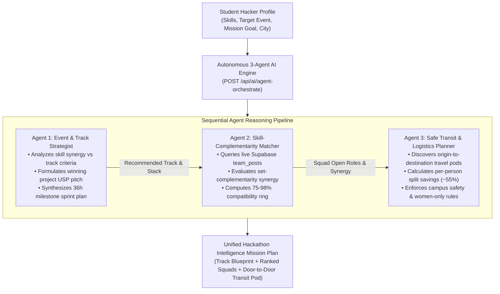
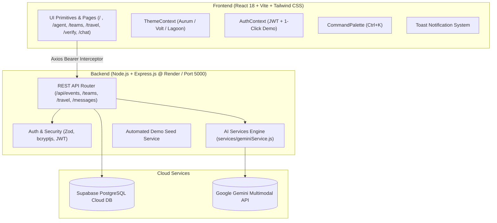

<div align="center">

# 🚀 HackSphere AI

### Autonomous Agentic AI Social Ecosystem for Tech Events, Skill-Based Teammate Matching & Safe Outstation Student Mobility

[](https://niat-liart.vercel.app/)
[](https://hacksphere-ai-backend.onrender.com/api)
[](https://ai.google.dev/)
[](https://supabase.com/)
[](LICENSE)

<p align="center">
  <strong>Built with passion for the NIAT National HackSprint 2026</strong><br>
  <em>Theme: Agentic AI & Intelligent Systems (Autonomous Multi-Agents, Multimodal Vision Trust, and Student Transit Hub)</em>
</p>

</div>

---

## 🌐 Live Deployments

| Component | Platform | URL | Health Check / Status |
| :--- | :--- | :--- | :--- |
| **Frontend Application** | **Vercel** | [https://niat-liart.vercel.app/](https://niat-liart.vercel.app/) | SPA with instant client-side routing & zero-404 rewrites |
| **Backend REST API** | **Render** | [https://hacksphere-ai-backend.onrender.com/api](https://hacksphere-ai-backend.onrender.com/api) | `GET /api/health` *(Note: Render free tier spins down after inactivity; initial ping wakes up in ~30–60s)* |
| **GitHub Repository** | **GitHub** | [https://github.com/RAYAPURAMVIKRAM/niat](https://github.com/RAYAPURAMVIKRAM/niat) | Continuous deployment connected to branch `main` |

---

## 📌 Problem Statement & Solution Overview

### The Triple Challenge Facing Student Hackers
Every year, over 300,000 engineering and tech students across India participate in premier national hackathons (Smart India Hackathon, ETHIndia, HackNITR, campus datathons). Despite high enthusiasm, hackers face three systemic friction points:

1. **The Teammate Complementarity Mismatch:** Students scramble through chaotic Discord channels, WhatsApp groups, and campus telegrams to recruit teammates. The result is often unbalanced squads (e.g. four frontend developers with zero backend/AI capabilities), conflicting vision hooks, and premature dropouts.
2. **The Outstation Mobility & Travel Safety Barrier:** Hackathons frequently take place in major tech hubs (Bengaluru, Chennai, Hyderabad, New Delhi, Pune). Solo travel is cost-prohibitive for students, sharing train sleeper berths or airport cabs lacks coordination, and female hackers face genuine travel safety anxieties without verified co-travelers.
3. **The Campus Identity & Trust Deficit:** Online hackathon team boards are plagued by unverified accounts, credential misrepresentation, and ghost hackers who disappear mid-sprint.

### The HackSphere AI Solution
HackSphere AI is an **Executive Agentic AI Social Ecosystem** that unifies competition discovery, autonomous project blueprinting, skill-complementarity squad formation, and verified outstation group transit:

- **Autonomous 3-Agent AI Command Center:** Orchestrates a sequential multi-agent reasoning chain powered by Google Gemini and Supabase PostgreSQL. Synthesizes winning project tracks, computes skill-complementarity synergy scores (75%–98%), and plans door-to-door transit itineraries.
- **2-Tier Student Trust Verification:** Combines instant institutional email validation (`.edu.in` / `.ac.in`) with **Gemini Multimodal Vision OCR** to verify physical college ID cards and issue cryptographic campus trust badges.
- **Safe Outstation Travel Pods:** Facilitates student carpools, sleeper train berth bookings, and cost splits (saving ~55% vs solo travel), featuring dedicated **Women-Only Safe Pods**.
- **Real-Time Collaboration & WebRTC Huddle Rooms:** Live discussion channels accompanied by an interactive simulated audio/video huddle bar with animated equalizer audio meters.
- **Phase 2 Executive Visual System:** A 3-theme color & typography engine (**Aurum**, **Volt**, **Lagoon**) with persistent switcher, command palette (`Ctrl/Cmd + K`), 3D perspective tilt cards, toast notifications, confetti bursts, and live stats counters.

---

## 🧠 3-Agent Autonomous Architecture



### 1. Agent 1: Event & Track Strategist
Analyzes the student's stated skills against the hackathon's prize tracks. Synthesizes a high-probability project blueprint complete with architecture recommendation, a winning USP pitch hook, and a 36-hour sprint milestone breakdown (Ideation $\rightarrow$ Core Engine $\rightarrow$ Agent Pipeline $\rightarrow$ Pitch Deck).

### 2. Agent 2: Skill-Complementarity Matcher
Executes set-complementarity matching against active bounties in the live Supabase PostgreSQL database. Rather than superficial keyword matching, Agent 2 identifies squads whose missing roles match the applicant's strengths, providing an animated circular SVG compatibility ring and explicit natural-language synergy insights.

### 3. Agent 3: Safe Transit & Logistics Planner
Matches the student's origin city and event host city against registered travel pods. Computes fare-sharing estimates, transit details (Shatabdi train, Volvo bus, flight carpool), and campus safety protocols, saving students up to 55% compared to solo outstation transit.

### 🛡️ Multimodal Trust Verification Engine (Gemini Vision OCR)
Analyzes uploaded physical college ID cards using Gemini Multimodal Vision. Scans for institutional seals, extracts student name and roll number, validates against registered student emails, and stamps the profile with a **Verified Student Hacker (.edu.in)** badge.

---

## 📸 Screenshots & Theme Gallery

> *Screenshots directory initialized at `docs/screenshots/.gitkeep`. Add updated product captures here.*

| Theme Name | Mood & Personality | Primary Palette | Display Font | Body & Mono Fonts |
| :--- | :--- | :--- | :--- | :--- |
| **Aurum** *(Default)* | Midnight Luxury Tech, Executive SaaS | Midnight Black (`#0A0A0B`), Pure White, Vibrant Golden Yellow (`#FFC21A`), Soft Ivory | `Fraunces` (Serif) | `Inter` / `JetBrains Mono` |
| **Volt** | Cyber Hacker, Terminal Velocity | Midnight Black (`#07080A`), Neon Lime (`#B6FF00`), Warm Ivory (`#F6F0E1`) | `Space Grotesk` | `DM Sans` / `Space Mono` |
| **Lagoon** | Fresh Campus Energy, Startup Mint | Soft Mint White (`#F4FAF8`), Deep Teal Green (`#0B4F4A`), Coral Orange (`#FF6B4A`) | `Outfit` / `Sora` | `Plus Jakarta Sans` / `IBM Plex Mono` |

---

## 🏛️ System Architecture



---

## 📂 Project Directory Structure

```
niat/
├── backend/
│   ├── src/
│   │   ├── config/
│   │   │   └── supabase.js         # Supabase client (Service Role + Anon Key)
│   │   ├── middleware/
│   │   │   └── auth.js             # JWT Bearer verification middleware
│   │   ├── routes/
│   │   │   ├── ai.js               # POST /agent-orchestrate, POST /verify-id
│   │   │   ├── auth.js             # POST /register, POST /login, GET /me
│   │   │   ├── events.js           # GET /events, POST /events, GET /:id
│   │   │   ├── messages.js         # GET /messages/:roomId, POST /messages
│   │   │   ├── teams.js            # GET /teams, POST /teams, POST /:id/join
│   │   │   └── travel.js           # GET /travel, POST /travel, POST /:id/join
│   │   └── services/
│   │       ├── geminiService.js    # Gemini LLM & Multimodal Vision caller + Fallback
│   │       └── seedService.js      # Idempotent demo database seeder
│   ├── .env.example
│   ├── package.json
│   ├── server.js                   # Express server entry point (Port 5000)
│   └── test-suite.js               # Automated 16-test backend validation suite
├── frontend/
│   ├── src/
│   │   ├── api/
│   │   │   └── client.js           # Axios instance with Bearer JWT interceptor
│   │   ├── components/
│   │   │   ├── ui/
│   │   │   │   ├── Avatar.jsx      # Deterministic DiceBear avatar + verified shield
│   │   │   │   ├── BackToTop.jsx   # Floating smooth scroll-to-top button
│   │   │   │   ├── Badge.jsx       # Status badges (verified, prize, women-only, etc.)
│   │   │   │   ├── Confetti.jsx    # Canvas confetti burst on actions
│   │   │   │   ├── CountUp.jsx     # Animated numbers for stats counters
│   │   │   │   ├── CoverImage.jsx  # Curated tech covers with mesh fallback
│   │   │   │   ├── EmptyState.jsx  # Illustrated zero-result state
│   │   │   │   ├── Marquee.jsx     # Infinite CSS marquee ticker
│   │   │   │   ├── ProgressRing.jsx# Circular animated SVG compatibility ring
│   │   │   │   ├── Reveal.jsx      # Staggered entrance animation wrapper
│   │   │   │   └── Skeleton.jsx    # Shimmer loaders for cards & lists
│   │   │   ├── AuthModal.jsx       # Sign in / Register modal
│   │   │   ├── CommandPalette.jsx  # Cmd+K quick navigation & action modal
│   │   │   ├── CreateTravelModal.jsx# Outstation travel pod creation modal
│   │   │   ├── Footer.jsx          # Executive footer with theme swatches
│   │   │   ├── HostEventModal.jsx  # Hackathon hosting modal
│   │   │   ├── HuddleBar.jsx       # WebRTC voice/video huddle bar with audio visualizer
│   │   │   ├── MobileNav.jsx       # Floating iOS/Android bottom dock
│   │   │   ├── Navbar.jsx          # Top bar with theme switcher, health dot & demo auth
│   │   │   ├── OnboardingModal.jsx # 3-step first-visit tour & theme picker
│   │   │   ├── PostTeamModal.jsx   # Teammate bounty creation modal
│   │   │   ├── RouteProgressBar.jsx# Top thin animated route transition bar
│   │   │   ├── Sidebar.jsx         # Executive desktop workspace navigation
│   │   │   └── ThemeSwitcher.jsx   # 3-palette theme switcher pill
│   │   ├── context/
│   │   │   ├── AuthContext.jsx     # JWT state, 1-click demo login, health polling
│   │   │   ├── ThemeContext.jsx    # Aurum / Volt / Lagoon theme provider
│   │   │   └── ToastContext.jsx    # Global toast notification system
│   │   ├── hooks/
│   │   │   └── useTilt.js          # 3D perspective mouse tilt hook
│   │   ├── pages/
│   │   │   ├── AgentPage.jsx       # 3-Agent AI Command Center (/agent)
│   │   │   ├── ChatPage.jsx        # Collaboration & Huddle Rooms (/chat)
│   │   │   ├── EventsPage.jsx      # Unified Events & Hackathons Feed (/)
│   │   │   ├── TeamsPage.jsx       # Teammate Bounties Matching Board (/teams)
│   │   │   ├── TravelPage.jsx      # Outstation Student Mobility Hub (/travel)
│   │   │   └── VerifyPage.jsx      # Gemini Vision ID Verification (/verify)
│   │   ├── App.jsx                 # Main layout & router orchestration
│   │   ├── index.css               # Theme CSS variables, glass utilities & keyframes
│   │   └── main.jsx
│   ├── .env.example
│   ├── index.html                  # Fonts preconnect & pre-mount theme script
│   ├── package.json
│   ├── tailwind.config.js          # Semantic token mappings & fluid type scale
│   ├── vercel.json                 # SPA rewrite rules
│   └── vite.config.js
├── docs/
│   └── screenshots/
│       └── .gitkeep
└── README.md
```

---

## 💻 Complete Technology Stack

| Layer | Technologies | Purpose |
| :--- | :--- | :--- |
| **Frontend Framework** | React 18, Vite | High-performance SPA with fast module replacement |
| **Styling & Design** | Tailwind CSS v3, PostCSS | Dynamic semantic token system with CSS RGB channels |
| **Client Routing** | React Router DOM v6 | Seamless multi-page routing with zero-404 SPA rewrites |
| **Icons & Typography** | Lucide React, Google Fonts | Fraunces, Space Grotesk, Outfit, Inter, Plus Jakarta Sans, JetBrains Mono |
| **HTTP Client** | Axios | Configured with automatic JWT Bearer interceptor |
| **Backend Runtime** | Node.js, Express.js | Modular CommonJS REST API for maximum cross-environment compatibility |
| **Validation** | Zod | Runtime type and schema validation for all endpoints |
| **Auth & Security** | bcryptjs, jsonwebtoken (JWT) | Password hashing (salt rounds: 10) & Bearer token authorization |
| **Cloud Database** | Supabase (PostgreSQL) | Managed cloud relational database with Service Role access |
| **Generative AI** | Google Gemini API (`@google/generative-ai`) | Multimodal LLM reasoning for 3-agent orchestration & ID card verification |
| **Zero-Crash Fallback** | Algorithmic State Engine | Realistic structured fallback ensuring 100% demo uptime if rate-limited |
| **Hosting & CI/CD** | Vercel (Frontend), Render (Backend) | Production continuous deployment directly from branch `main` |

---

## 📡 API Reference Table

All endpoints are prefixed with `/api`.

| Method | Path | Description | Auth Required |
| :--- | :--- | :--- | :---: |
| `GET` | `/api/health` | Service health status check | No |
| `POST` | `/api/auth/register` | Register student profile (Zod validation, domain check) | No |
| `POST` | `/api/auth/login` | Student login (returns JWT token & user profile) | No |
| `GET` | `/api/auth/me` | Fetch currently authenticated user profile | **Yes (Bearer)** |
| `GET` | `/api/events` | List all hackathons (supports `?city=` and `?search=`) | No |
| `POST` | `/api/events` | Host / publish a new hackathon event | **Yes (Bearer)** |
| `GET` | `/api/events/:id` | Fetch event details with linked teams and pods | No |
| `GET` | `/api/teams` | List teammate bounties (supports `?event_id=`) | No |
| `POST` | `/api/teams` | Post a teammate bounty (Looking For Teammate) | **Yes (Bearer)** |
| `POST` | `/api/teams/:id/join` | Join squad (decrements open spots) | No |
| `GET` | `/api/travel` | List travel pods (supports `?origin=`, `?destination=`, `?women_only=`) | No |
| `POST` | `/api/travel` | Create outstation travel pod with cost split estimate | **Yes (Bearer)** |
| `POST` | `/api/travel/:id/join` | Reserve seat in travel pod (decrements seats) | No |
| `GET` | `/api/messages/:roomId` | Fetch message history for chat/huddle channel | No |
| `POST` | `/api/messages` | Post a real-time message to channel | No |
| `POST` | `/api/ai/agent-orchestrate` | **Autonomous 3-Agent AI Workflow Orchestrator** | No |
| `POST` | `/api/ai/verify-id` | **Gemini Multimodal Vision College ID Verification** | No |

---

## 🚀 Getting Started & Local Execution

### Prerequisites
- **Node.js**: v18.0.0 or higher
- **npm**: v9.0.0 or higher
- **Git**

### 1. Clone the Repository
```bash
git clone https://github.com/RAYAPURAMVIKRAM/niat.git
cd niat
```

### 2. Backend Setup
```bash
cd backend
npm install
```

Create `backend/.env` (refer to `backend/.env.example`):
```env
PORT=5000
SUPABASE_URL=your_supabase_url
SUPABASE_SERVICE_ROLE_KEY=your_supabase_service_role_key
SUPABASE_ANON_KEY=your_supabase_anon_key
JWT_SECRET=your_jwt_secret
GEMINI_API_KEY=your_gemini_api_key
```

Start the backend:
```bash
npm start
# Server runs on http://localhost:5000
# Health check: http://localhost:5000/api/health
```

Run the automated test suite (16/16 tests passing):
```bash
node test-suite.js
```

### 3. Frontend Setup
In a new terminal window:
```bash
cd frontend
npm install
```

Create `frontend/.env` (refer to `frontend/.env.example`):
```env
VITE_API_URL=http://localhost:5000/api
```

Start the Vite development server:
```bash
npm run dev
# Application opens at http://localhost:5173
```

---

## ⚡ 2-Minute Demo Walkthrough for Evaluators & Judges

1. **Instant Demo Authentication:**
   - Open [https://niat-liart.vercel.app/](https://niat-liart.vercel.app/).
   - Click the **"⚡ Instant Demo Login"** button in the header (or in the Sign In modal).
   - Instantly authenticates as **Rayapuram Vikram (Lead Architect @ NIAT x Yenepoya University)**. The green **Verified Student (.edu.in)** badge immediately appears in the navigation bar.

2. **Explore the Unified Events Feed (`/`):**
   - Review live hackathons with prize pool badges, countdown tags, and attendance counters.
   - Test the live filter pills (`Hackathon`, `Datathon`, `Tech Fest`) and city selectors.
   - Click the heart icon to save favorite events with instant toast notifications.

3. **Deploy the Autonomous 3-Agent Command Center (`/agent`):**
   - Click **"Launch 3-Agent AI Command Center"**.
   - Select a target hackathon (e.g., *SIH 2026 - Smart India Hackathon*).
   - Click **"🚀 Launch Autonomous 3-Agent Workflow"**.
   - Watch the sequential 3-agent execution timeline synthesize the track blueprint, rank complementary squads with circular compatibility rings, and generate door-to-door transit plans.
   - Click **"Request to Join"** or **"Join Travel Pod"** to trigger live database updates and confetti bursts!

4. **Verify College Student ID with Gemini Vision (`/verify`):**
   - Click **"⚡ Use Sample NIAT ID Card"** to generate an institutional student ID on the canvas.
   - Click **"🔍 Verify College ID with Gemini Vision AI"**.
   - Observe the laser scanline overlay (`animate-scan-line`) perform neural OCR and issue a **98% Trust Score** and Verified Student Credential.

5. **Test Outstation Travel Pods (`/travel`):**
   - Filter by origin, destination, and toggle **🛡️ Women-Only Safe Pods**.
   - Inspect estimated per-person split costs and reserved seats.

6. **Switch Themes & Use Command Palette:**
   - Click the Theme Switcher pill in the navbar to toggle between **Aurum** (Gold/Black), **Volt** (Neon Lime), and **Lagoon** (Teal/Coral). Refresh the page to verify persistent theme memory!
   - Press **`Ctrl + K`** (or **`Cmd + K`**) to open the command palette and jump between routes instantly.

---

## 🎨 Design System & Fluid Typography

### Color Tokens
Colors are defined as RGB channel variables in `src/index.css` under `:root[data-theme="..."]` and mapped via `rgb(var(--color) / <alpha-value>)` in `tailwind.config.js`:

- `--bg`, `--surface`, `--surface-2`, `--surface-ivory`, `--surface-ivory-fg`
- `--fg`, `--muted`, `--border`, `--brand`, `--brand-fg`, `--accent`, `--accent-fg`
- `--success`, `--warning`, `--danger`, `--ring`

### Fluid Typography Scale (`clamp()`)
- `text-hero`: `clamp(2.4rem, 5vw + 1rem, 4.5rem)`
- `text-h1`: `clamp(1.9rem, 3.5vw + 0.5rem, 3rem)`
- `text-h2`: `clamp(1.4rem, 2.5vw + 0.25rem, 2.1rem)`
- `text-h3`: `clamp(1.15rem, 1.8vw + 0.2rem, 1.5rem)`

### How to Add a New Theme
1. Open `frontend/src/index.css` and append a new `:root[data-theme="your-theme-name"]` selector specifying all RGB channel variables and font tokens.
2. Open `frontend/src/context/ThemeContext.jsx` and register the new theme object in the `THEMES` array with its display name and swatch colors.

---

## 🚢 Deployment Architecture

- **Frontend (Vercel)**: Configured with `frontend/vercel.json` rewrite rule `{ "rewrites": [{ "source": "/(.*)", "destination": "/index.html" }] }` to support HTML5 PushState client-side routing.
- **Backend (Render)**: Node.js web service running `node server.js` on port 5000 with environment variables for Supabase and Gemini.
- **CORS Configuration**: Fully open `origin: '*'` allowing seamless cross-origin communication between Vercel and Render.

---

## 🤝 Contributing

Contributions from student developers and hackathon builders are welcome!
1. Fork the Project
2. Create your Feature Branch (`git checkout -b feature/AmazingFeature`)
3. Commit your Changes (`git commit -m 'feat: add amazing feature'`)
4. Push to the Branch (`git push origin feature/AmazingFeature`)
5. Open a Pull Request

---

## 📄 License & Attribution

Distributed under the **MIT License**. See `LICENSE` for more information.

**Author & Project Lead:**  
**Rayapuram Vikram** — Full Stack AI Architect & Engineer (NIAT x Yenepoya University)  
GitHub: [@RAYAPURAMVIKRAM](https://github.com/RAYAPURAMVIKRAM)
